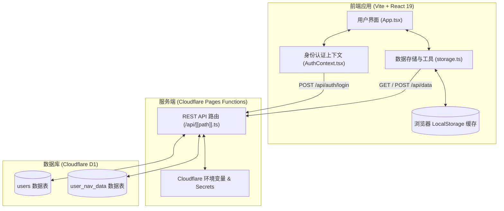
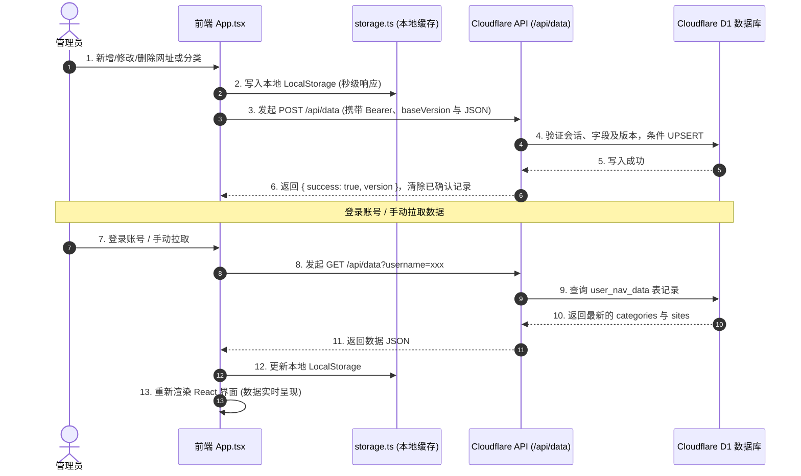

# ApexNav 系统架构与数据同步链路文档 (System Architecture)

本文档旨在详述 **ApexNav** 的整体软件架构设计、组件职责划分、数据持久化机制与跨设备数据同步链路。

当前同步实现：界面先保存账号本地缓存和持久化待上传记录，同一页面内的上传按顺序发送；分类和网址一起更新，节点独立更新。待上传记录按服务地址、账号和标签页隔离。恢复联网或每 30 秒重试未完成上传；发生冲突后停止自动重试。登录及手动拉取读取云端数据，没有云端数据轮询或服务端推送。存在未上传修改、退出、切换账号或被新编辑超越的读取结果不会覆盖本地编辑。

读取接口返回数据版本，写入必须携带 `baseVersion`。后端校验字段并以单条条件 UPSERT 比较已有快照，保留未提供的字段；旧版本写入返回 409，缺少版本返回 428。重复提交已经写入的相同字段可安全确认成功。冲突时，用户在设置中明确选择本地或云端版本；选择前导出备份并保存待上传记录。此机制不自动合并两份不同的书签编辑。

版本来自现有 JSON 列的摘要，无需新增数据库字段。前后端必须同时发布，旧客户端需刷新。代其他标签页上传不更新当前页面的编辑版本，避免旧页面获得覆盖新数据的权限。

API 使用服务端签发的 Bearer 会话验证账号，升级要求与凭证说明见 [SECURITY.md](SECURITY.md)。

---

## 🏗️ 系统架构图 (Architecture Diagram)



---

## 🔄 数据同步链路与生命周期 (Synchronization Data Flow)

ApexNav 的正常上传和读取流程如下；冲突或断网时保留本地待上传记录并提示用户：



---

## 💾 数据持久化与降级策略 (Persistence & Fallback Strategy)

ApexNav 设计了 3 层数据回退机制，确保在各种网络与配置环境下均能稳定运行：

```
┌────────────────────────────────────────────────────────┐
│  Tier 1: Cloudflare D1 边缘数据库 (服务端数据源)          │
└───────────────────────────┬────────────────────────────┘
                            │ (D1 未绑定 / 离线时降级)
                            ▼
┌────────────────────────────────────────────────────────┐
│  Tier 2: 浏览器 LocalStorage (账号隔离本地缓存)          │
└───────────────────────────┬────────────────────────────┘
                            │ (未登录访客模式降级)
                            ▼
┌────────────────────────────────────────────────────────┐
│  Tier 3: 默认通用演示数据 (DEFAULT_CATEGORIES / SITES)   │
└────────────────────────────────────────────────────────┘
```

1. **第一层 (D1 数据库)**：已登录账号且 Cloudflare D1 已绑定时，同步分类、网址及监控节点。
2. **第二层 (LocalStorage)**：本地保存导航缓存、待上传记录、待办、便签、倒计时、收藏语录、城市及组件配置。个人组件按账号隔离，目前不自动云同步；浏览器清理数据或存储配额不足会影响本地保存，需另存备份。
3. **第三层 (默认预设数据)**：未登录访客访问时，呈现通用的演示导航网格，隔离管理员数据。

## 备份与导入

JSON 2.0 备份包括导航、节点、当前账号个人组件、界面偏好，以及待同步和冲突归档，不含会话或密码。兼容旧版 1.0 书签备份和浏览器 HTML 书签。导入上限为 8 MiB；前后端都校验结构、ID、引用和 URL 协议。HTML 导出转义文本和属性，缺失分类的网址放入恢复分类。

追加导入只合并分类和网址；替换导入前触发下载当前备份，再恢复文件中提供的其他字段。`pending` 和 `recovery` 是人工恢复参考记录，不会直接重放到云端。替换并非跨浏览器存储键的事务。旧版未按账号划分的个人组件数据需在设置中明确导入，访客和其他账号不会自动认领。

网络搜索建议默认关闭；启用后由后端固定请求百度建议接口，限制响应大小和超时，解析为 JSON 数据返回，浏览器不执行第三方 JSONP。无论当前搜索引擎为何，网络建议提供方均为百度。

---

## 📁 目录结构与模块职责 (Directory Structure)

```text
ApexNav/
├── functions/               # Cloudflare Pages Functions 服务端后端代码
│   └── api/
│       └── [[path]].ts      # 认证、数据同步、分类与节点 REST API 统一路由
├── public/                  # 静态资源与预览截图
├── src/
│   ├── components/          # 视图组件
│   │   ├── BookmarkGrid.tsx    # 网址分类网格卡片与右键/内联操作
│   │   flex SearchHero.tsx       # 4 大搜索引擎、搜索建议与书签本地搜索
│   │   ├── SettingsModal.tsx    # macOS 风格双栏控制台 (网址/分类/数据/安全)
│   │   ├── PinModal.tsx         # 登录与密码弹窗
│   │   ├── StatusMonitorCard.tsx# 节点在线监控与延迟检测卡片
│   │   ├── Header.tsx           # 顶部导航栏 (时钟/切换壁纸/锁屏)
│   │   └── WidgetsGrid.tsx      # 日历、实时天气、每日一言挂件网格
│   ├── contexts/
│   │   └── AuthContext.tsx      # 管理员认证状态机与 Session 隔离
│   ├── utils/
│   │   └── storage.ts           # 存储工具库 (账号隔离、D1 API 交互)
│   ├── types.ts                 # TypeScript 数据模型与接口定义
│   ├── App.tsx                  # 应用入口与全局状态调度
│   └── main.tsx                 # React DOM 渲染入口
├── README.md                # 项目开源主页与快速上手指引
├── SECURITY.md              # 安全规范与零信任架构指南
├── ARCHITECTURE.md          # 本文档 (系统架构与数据流向)
└── schema.sql               # D1 数据库初始化表结构 SQL
```
